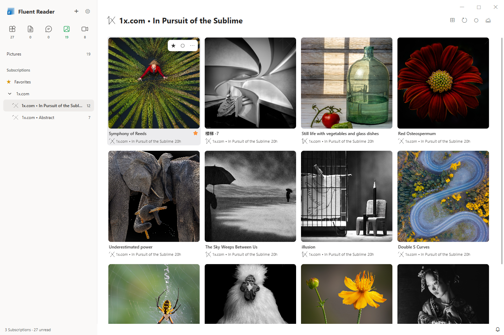

<p align="center">
  
</p>
<h3 align="center">Fluent Reader</h3>
<p align="center">A modern desktop RSS reader</p>
<p align="center">
  
  
  
</p>
<hr />

## Download

For Windows 10 users, the recommended way of installation is through [Microsoft Store](https://www.microsoft.com/store/apps/9P71FC94LRH8?cid=github). 
This enables auto-update and experimental ARM64 support. 
macOS users can also get Fluent Reader from the [Mac App Store](https://apps.apple.com/app/id6761698838).

If you are using Linux or an older version of Windows, you can [get Fluent Reader from GitHub releases](https://github.com/yang991178/fluent-reader/releases).

### Mobile App

The repo of the mobile version of this app [can be found here](https://github.com/yang991178/fluent-reader-lite).

## Features

<p align="center">
  
</p>

- A modern UI inspired by Fluent Design System with full dark mode support.
- Read locally or sync with self-hosted services compatible with Fever or Google Reader API.
- Sync with RSS Services including Inoreader, Feedbin, The Old Reader, BazQux Reader, and more.
- Importing or exporting OPML files, full application data backup & restoration.
- Read the full content with the built-in article view or load webpages by default.
- Search for articles with regular expressions or filter by read status.
- Switch between articles, social media, pictures, and videos with dedicated layouts.
- Group subscriptions automatically by website or create your own groups, with drag-and-drop organization.
- Browse favorites within each content category, with persistent star markers on media cards.
- Manage subscriptions and groups with searchable lists, detail panels, and saved ordering.
- Choose automatic or manual read marking per subscription or group.
- Read media in an overlay or in the second column, with breadcrumbs and an article switching menu.
- Single-key [keyboard shortcuts](https://github.com/yang991178/fluent-reader/wiki/Support#keyboard-shortcuts).
- Hide, mark as read, or star articles automatically as they arrive with regular expression rules.
- Fetch articles in the background with per-source update policies, publication-based scheduling, and website request limits.
- Send push notifications for new articles.

### Design reference

The current UI layout and interaction flow in this development branch are designed
with [Folo](https://github.com/RSSNext/Folo) as a reference. This includes content
categories, website grouping, drag-and-drop organization, media card layouts,
category-specific favorites, and inline reading with breadcrumb navigation.

These interactions are adapted to Fluent Reader's existing Electron and React
architecture. Thanks to the Folo team for the design and interaction inspiration.

### Current interface and usage

See the [current preview gallery](docs/previews/README.md) for reading layouts, settings,
group management, favorites, and dark mode. The [Chinese usage guide](docs/reader-guide.md)
explains grouping, update policies, read marking, and inline media navigation.

The screenshots were refreshed on October 1, 2026 with the English interface and real
cached subscriptions in isolated profiles. Feed content remains in its original language;
the settings shown are examples rather than application defaults.

Support for other RSS services are [under fundraising](https://github.com/yang991178/fluent-reader/issues/23). 

## Development

### Contribute

Help make Fluent Reader better by reporting bugs or opening feature requests through [GitHub issues](https://github.com/yang991178/fluent-reader/issues). 

You can also help internationalize the app by providing [translations into additional languages](https://github.com/yang991178/fluent-reader/tree/master/src/scripts/i18n). 
Refer to the repo of [react-intl-universal](https://github.com/alibaba/react-intl-universal) to get started on internationalization. 

If you enjoy using this app, consider supporting its development by donating through [GitHub Sponsors](https://github.com/sponsors/yang991178), [Paypal](https://www.paypal.me/yang991178), or [Alipay](https://hyliu.me/fluent-reader/imgs/alipay.jpg).

### Build from source
```bash
# Install dependencies
npm install

# Compile ts & dependencies
npm run build

# Start the application
npm run electron

# Generate certificate for signature
electron-builder create-self-signed-cert
# Package the app for Windows
npm run package-win

```

### Developed with

- [Electron](https://github.com/electron/electron)
- [React](https://github.com/facebook/react)
- [Redux](https://github.com/reduxjs/redux)
- [Fluent UI](https://github.com/microsoft/fluentui)
- [Lovefield](https://github.com/google/lovefield)
- [Mercury Parser](https://github.com/postlight/mercury-parser)

### License

BSD
