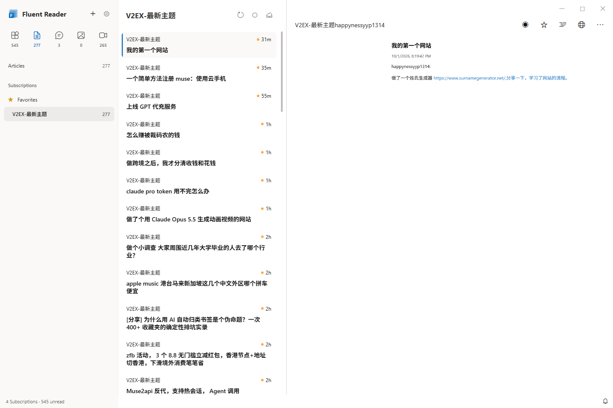
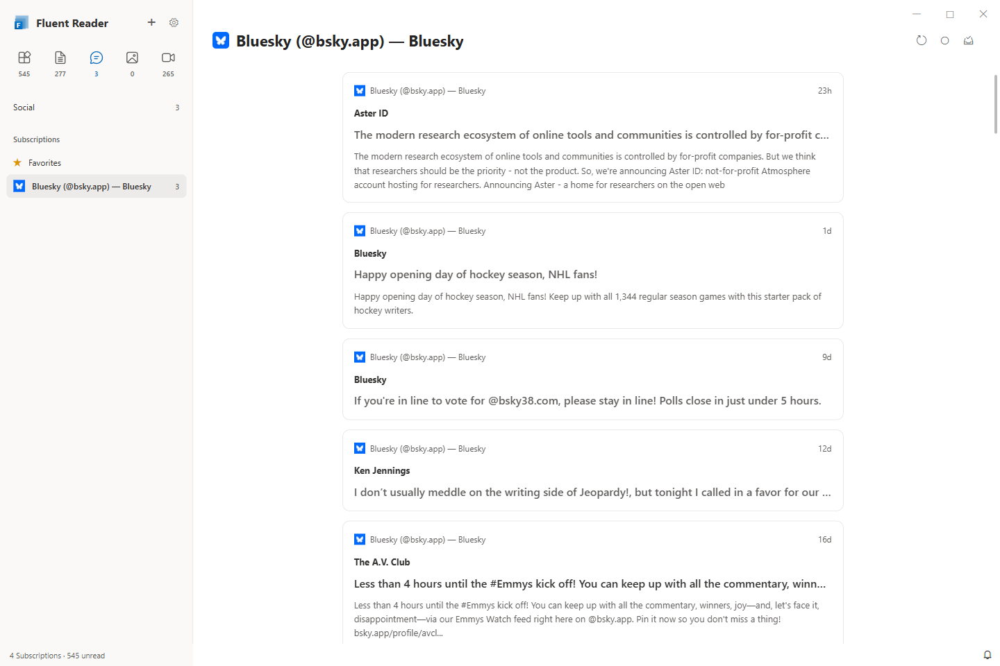
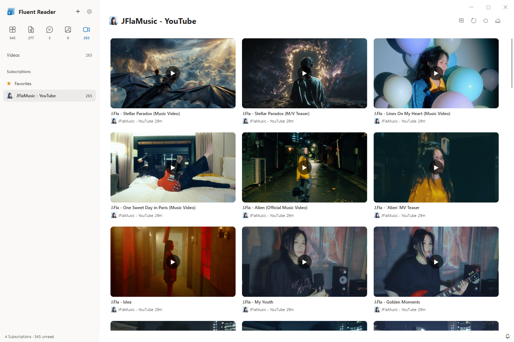
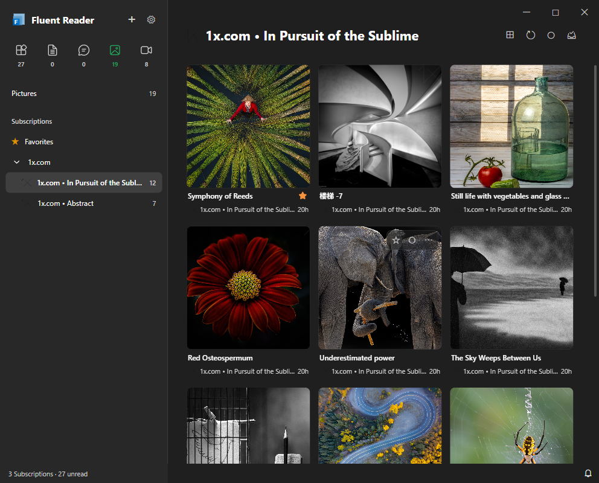

# 当前界面预览

更新于 **2026-10-01**，对应提交 `914791f` 的界面。

所有图片均为当前 Electron 程序的实际截图，**界面语言统一为英文（English）**，订阅名称与内容保留来源原文。展示内容来自真实订阅的本地缓存副本：文章使用 V2EX，社交媒体使用 Bluesky，图片使用 1x，视频使用 JFlaMusic / YouTube。设置截图还展示 NASA 订阅。拍摄过程中关闭自动更新，未请求 RSSHub，也未修改日常使用的数据。

预览使用两份隔离缓存，因此不同截图中的订阅数量和未读数可能不同。收藏及阅读设置用于演示相应功能，不代表应用默认设置。

常规窗口为 **1440 × 960**，窄窗口为 **992 × 800**，均按界面逻辑像素保存。当前操作说明见[使用指南](../reader-guide.md)。

| 预览 | 展示内容 |
| --- | --- |
| [文章](articles.png) | 三栏阅读、独立滚动的文章列表和阅读区。 |
| [社交媒体](social.png) | Bluesky 时间线与固定标题栏。 |
| [图片](pictures.png) | 四列图片网格、网站分组和常驻收藏星标。 |
| [视频](videos.png) | 三列 16:9 视频封面与播放提示。 |
| [收藏](favorites.png) | 图片分类内的收藏内容。 |
| [就地阅读](inline-reader.png) | 侧栏保留，第二栏展示内容详情和面包屑。 |
| [文章菜单](article-menu.png) | 订阅源名称旁的缓存文章菜单及当前文章勾选。 |
| [应用偏好](settings.png) | 更新、同站请求控制、已读规则与统一 SVG 控件。 |
| [订阅源设置](subscriptions.png) | 可搜索列表与右侧详情编辑。 |
| [分组规则](group-rules.png) | 可搜索分组列表与选中分组规则。 |
| [分组成员](group-members.png) | 组内成员搜索、编辑、移出和排序。 |
| [窄窗口深色图片页](dark-narrow.png) | 992px 窗口下的深色网格。 |
| [窄窗口深色设置页](settings-dark-narrow.png) | 窄窗口下的设置面板和 SVG 箭头。 |

## 阅读布局

## 阅读导航

## 设置与分组

## 深色与窄窗口

