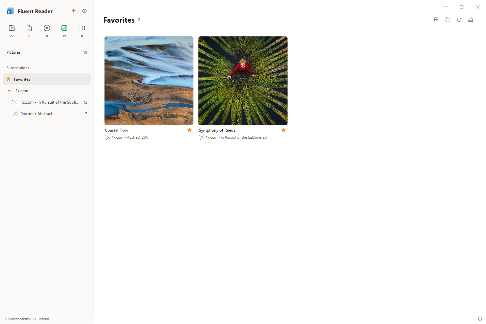
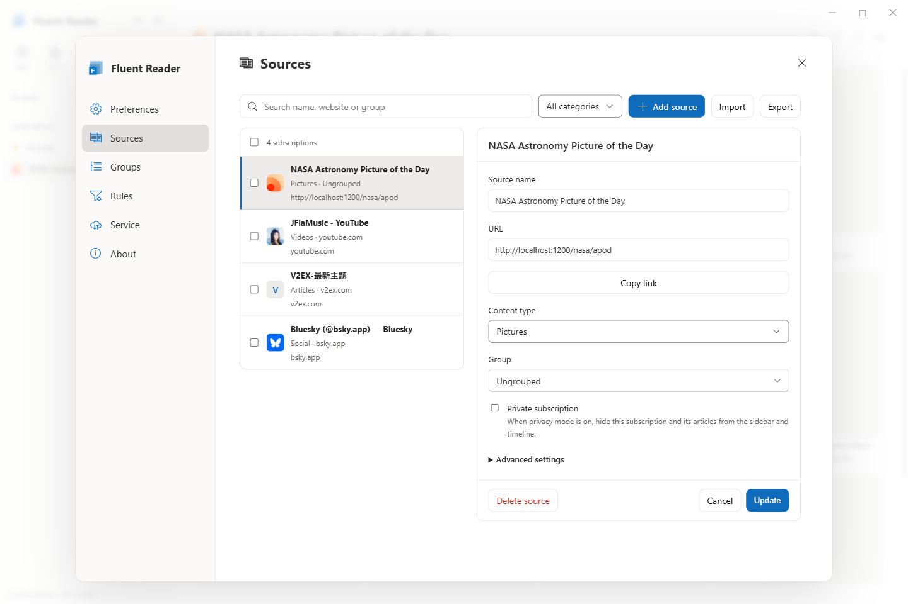
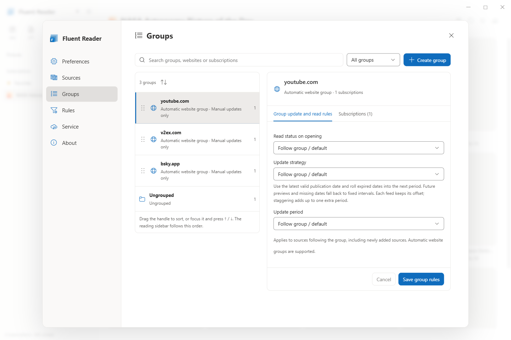
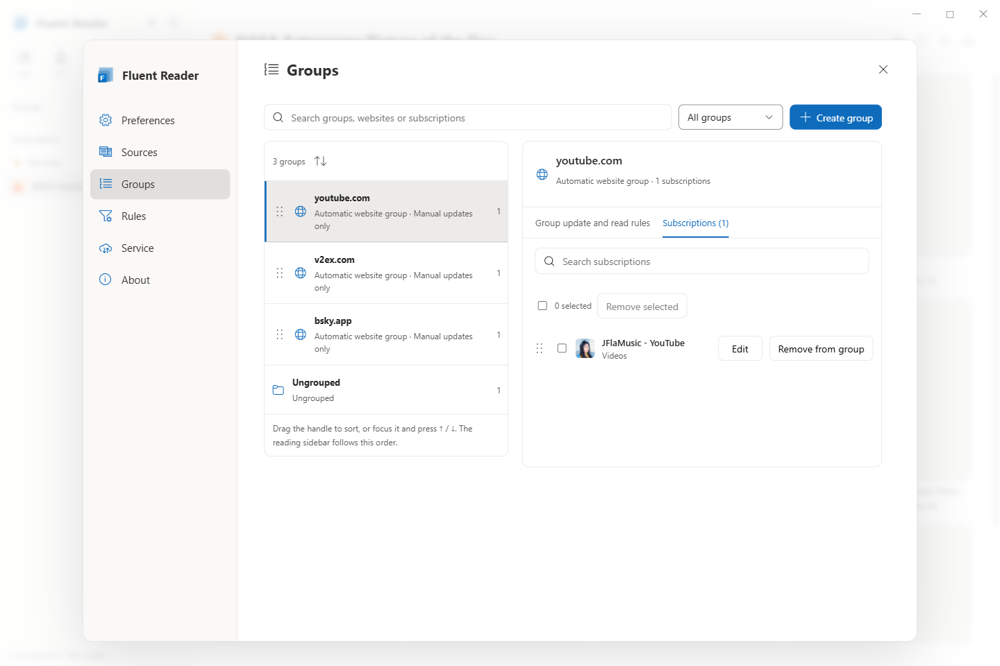
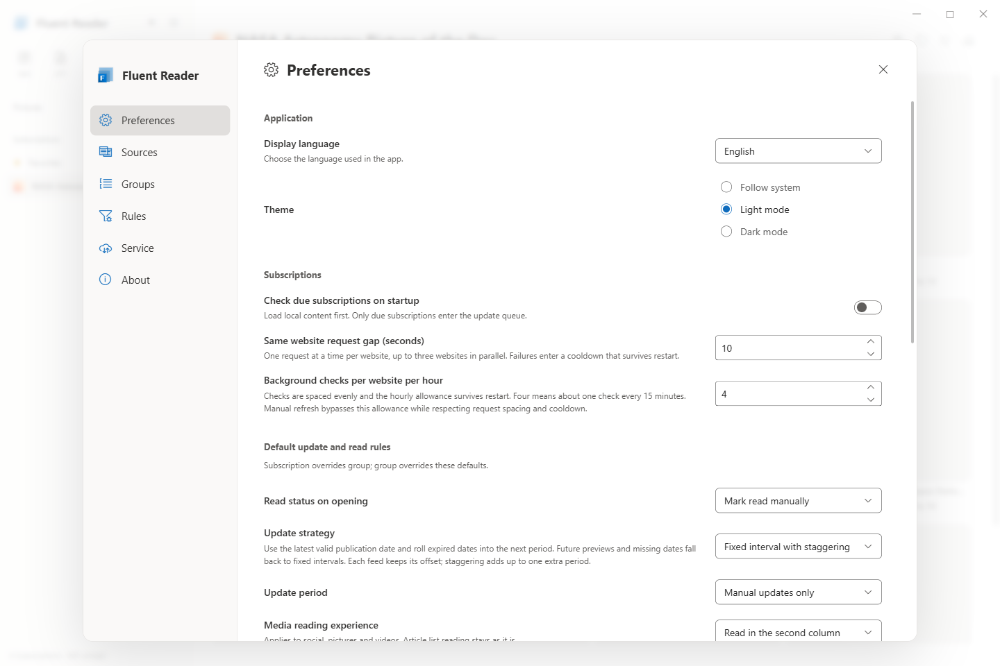
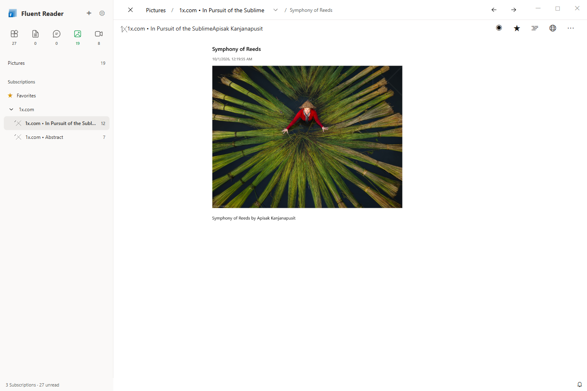
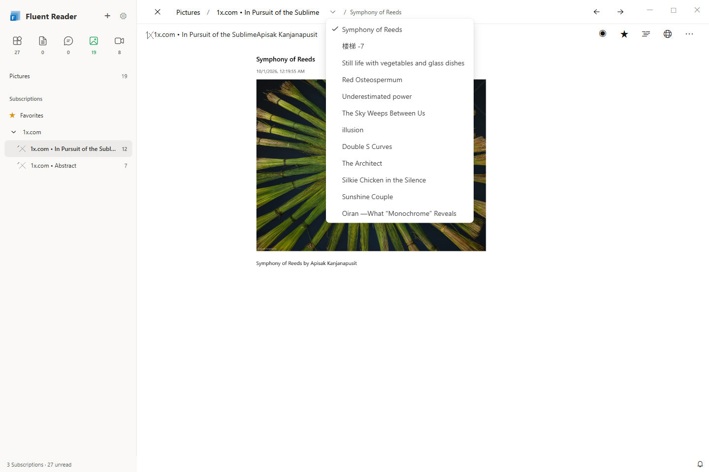
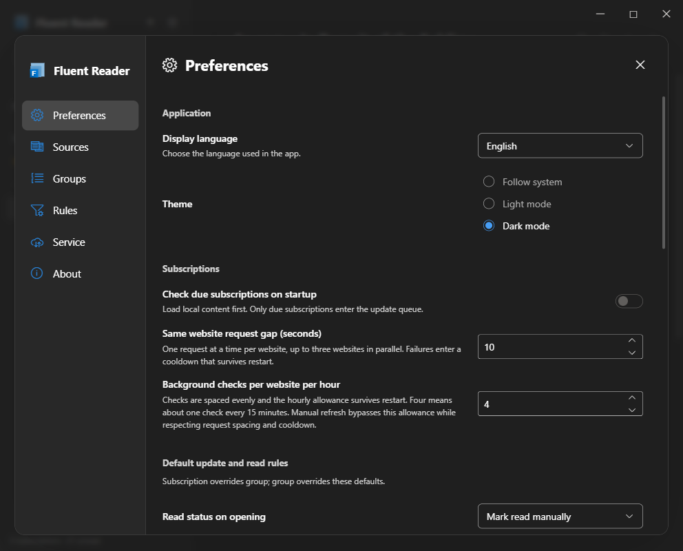

# Fluent Reader 当前界面与使用说明

这是一份面向使用者的操作手册，介绍新增功能的设置入口和使用方法。

本页对应当前开发分支的界面，更新于 **2026-10-01**。查看[完整预览图](previews/README.md)。说明使用中文，预览图统一使用英文界面，订阅内容保留来源原文。

截图中的常用入口对应如下：

| 中文说明 | 英文界面 |
| --- | --- |
| 应用偏好 | Preferences |
| 订阅源设置 | Sources |
| 分组与排序 | Groups |
| 收藏 | Favorites |
| 第二栏就地阅读 | Read in the second column |
| 返回列表 | Return to list |

## 分类与阅读布局

侧栏顶部提供全部、文章、社交媒体、图片和视频入口，图标下方显示未读数量。

| 内容 | 布局与操作 |
| --- | --- |
| 文章 | 订阅栏、文章列表、阅读区三栏布局；可拖动列表与阅读区之间的分隔线调整宽度。 |
| 社交媒体 | 时间线卡片；标题和操作栏固定，内容区独立滚动。 |
| 图片 | 紧凑图片网格；封面下方显示标题、订阅源和时间。 |
| 视频 | 16:9 封面网格；卡片提供播放提示、标题和来源。 |

图片和视频页右上角的布局菜单可设置每行数量，或使用自动列数适应窗口宽度；图片页还可切换仅显示图片。媒体封面不会随鼠标拖动触发浏览器原生图片拖出。

工具栏的刷新按钮和 F5 刷新当前选择范围：选择“全部”时刷新全部可见订阅源，选择内容分类时只刷新该分类，选择分组时只刷新当前组内的源，选择单个订阅源时只刷新该源。未读、搜索等文章筛选不会缩小订阅源的刷新范围。

## 自动分组、手动分组与拖动

内容分类决定阅读布局，分组用于整理订阅源，两者可以分别调整。

- 有可用网站地址时，自动分组按原网站域名整理订阅源；通过 RSSHub 订阅时优先使用识别出的原网站信息。
- 编辑订阅源时，分组框既能下拉选择，也能输入名称。输入新名称并保存后创建手动分组。
- 选择“未分组”可以让订阅源独立显示。
- 将订阅源拖到侧栏分组中，可以加入该分组；拖到“订阅源”标题的移出区域，可以退出分组。
- 将订阅源拖到顶部内容分类图标，可以更换文章、社交媒体、图片或视频分类。
- 分组展开按钮拥有独立点击区域；展开后显示组内订阅源。

## 收藏

每个内容分类都有“收藏”入口，显示属于当前分类的已收藏内容。例如图片分类的收藏入口只显示已收藏的图片内容。

已收藏的图片和视频卡片，在文字区右侧常驻显示实心星标。鼠标移开后星标仍保留，用于提醒该内容已收藏；悬停快捷操作可以收藏或取消收藏，无需打开显示开关。

## 设置：订阅源

打开侧栏顶部的设置按钮，选择“订阅源”。左侧列表支持按名称、网站或分组搜索，并可按内容分类筛选。点击某个订阅源后，在右侧详情中修改名称、分类、分组、私密标记及高级选项，最后点击“更新”保存。

勾选多个订阅源可批量修改分类和分组。导入、导出和添加入口位于列表上方。

## 设置：分组与排序

左侧展示可搜索、筛选的分组列表，右侧直接显示选中分组的详情，不需要再从下拉框重复选择。

- “分组更新与已读规则”页签设置该组成员继承的更新周期、更新策略和已读行为。
- “订阅源”页签显示组内成员，可搜索、编辑、移出及调整顺序。手动分组支持添加已有订阅源。
- 拖动分组或成员的排序手柄调整顺序，也可聚焦手柄后按上、下方向键排序；顺序会保存，并用于阅读侧栏。
- 自动网站分组和手动分组均可设置规则；以后加入的订阅源也可以继承。
- 删除手动分组会保留其订阅源和缓存内容，成员转为未分组。
- 窄窗口下，详情区移到分组列表下方。

## 更新策略与同站请求控制

在“应用偏好”中设置默认更新与已读规则；在订阅源高级设置或分组规则中可以覆盖默认值。优先级为 **订阅源设置 → 分组设置 → 全局默认**。

| 设置 | 行为 |
| --- | --- |
| 启动时检查到期订阅源 | 启动先显示本地内容，仅把到期订阅源加入后台更新队列；关闭后不执行启动检查。 |
| 更新周期 | 从分钟到数周选择周期，也可以自定义分钟数或选择仅手动更新。 |
| 固定间隔＋错峰 | 根据上次抓取时间、更新周期和该订阅源固定的错峰位置安排下次更新。 |
| 按发布时间对齐 | 使用最新有效发布时间和更新周期安排下次检查；过期计划顺延，未来预告或缺少日期时使用固定间隔兜底。 |
| 同站请求间隔（秒） | 同一网站的请求串行执行，并保持最小间隔；不同网站最多三个并行。 |
| 每个网站每小时的后台检查额度 | 均匀分配同站后台检查时间，避免大量到期源在启动时集中请求；额度及冷却状态会保留到下次启动。 |

每个源的错峰位置会保存，额外延迟小于一个更新周期。对于发布缓慢的源，可以在源或分组规则中设置每周等较长周期。桌面端限流与 RSSHub 服务端缓存可同时使用。

手动刷新可以跳过更新周期和后台额度，仍遵守同站请求间隔与失败冷却。更新时设置页仍可使用，不再被整页等待遮罩阻挡。打开设置会暂停尚未开始的自动任务，关闭后按新规则继续检查；已经开始的请求及手动更新队列不因此暂停。

订阅源右键菜单的刷新只更新该订阅源，分组右键菜单的刷新只更新组内订阅源；同样跳过更新周期与后台额度，默认遵守同站请求间隔和失败冷却。

手动刷新遇到请求间隔或失败冷却时，右下角会合并显示等待原因、剩余时间及更新进度。可以等待自动继续、取消剩余请求，或选择“立即刷新／立即尝试”，只跳过当前正在等待的请求，不修改长期策略。同站请求仍然串行；再次遇到网站限流或人机验证时，该站本轮剩余请求会停止并显示原因。关闭正在等待的通知会取消剩余请求，已开始的请求会正常结束。自动刷新不弹出这些通知。

“自动抓取频率”决定运行中多久扫描一次到期源，与单个订阅源的更新周期分别控制。设置为“从不”会停止定时扫描，但已经开始的启动队列仍按网站额度继续执行。

## 已读规则

选择“打开后自动标记已读”，阅读内容时会标记为已读。选择“仅手动标记已读”，打开内容不会改变未读状态，需要手动操作。

规则可按订阅源、分组或全局设置。需要保留待处理内容时，可为相应分组设置手动标记，其他订阅源继续使用自动标记。

## 第二栏就地阅读与文章菜单

在“应用偏好 → 媒体内容阅读方式”中，选择独立弹层或“第二栏就地阅读”。该设置适用于社交媒体、图片和视频；文章分类继续使用三栏阅读布局。

就地阅读时，侧栏保留，第二栏从卡片列表切换成内容详情。顶部为面包屑导航：

- 点击返回按钮或分类名称，回到原列表。
- 点击订阅源名称，返回该源列表；已在同一个源内时保留列表滚动位置。
- 点击订阅源名称旁的小箭头，展开该源的本地文章菜单；当前文章带勾选标记。
- 菜单按发布时间排序，沿用当前筛选条件；选择文章后继续就地阅读，并应用该源的已读规则。
- 菜单只读取缓存，不触发订阅更新；内容较多时可继续加载。
- 支持键盘打开、移动和选择，Esc 或点击菜单外部关闭。

## 设置窗口与深色模式

设置面板可以从顶部标题区域拖动，右侧内容独立滚动。选择应用偏好中的浅色、深色或跟随系统主题；设置下拉框和数字增减箭头均使用 SVG，并保持统一的居中、间距和圆角。

私密订阅标记和“隐藏私密订阅”开关可控制本机显示；该功能不删除或加密订阅数据。本地订阅查询 API 的开关、接口与鉴权说明见[本地 API 文档](local-api.md)。
